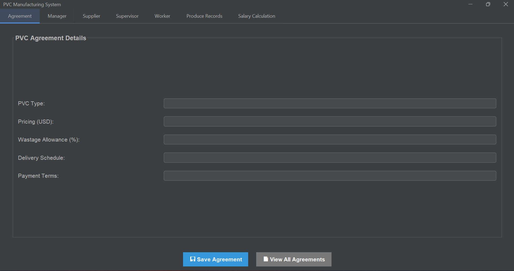
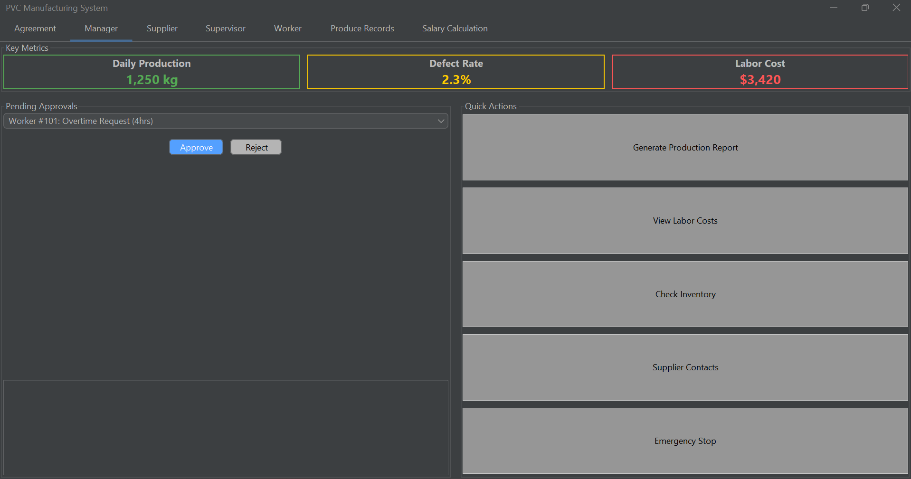
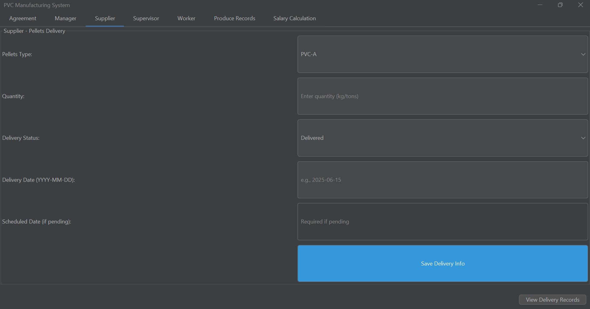
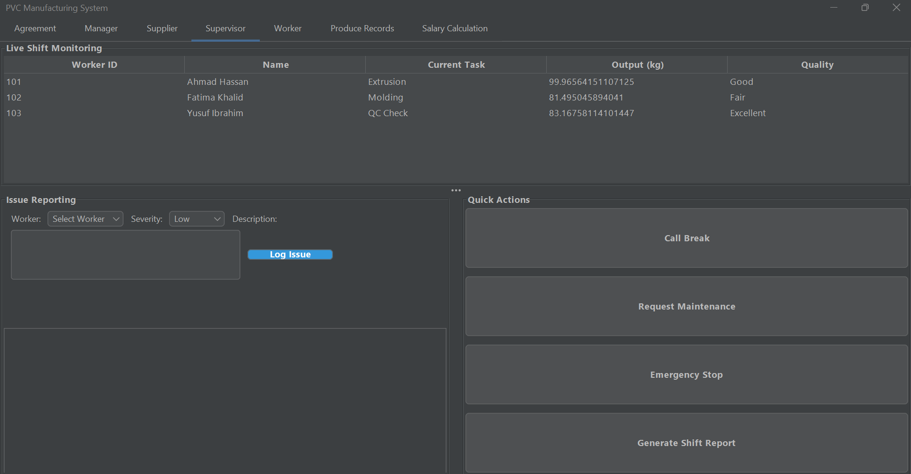
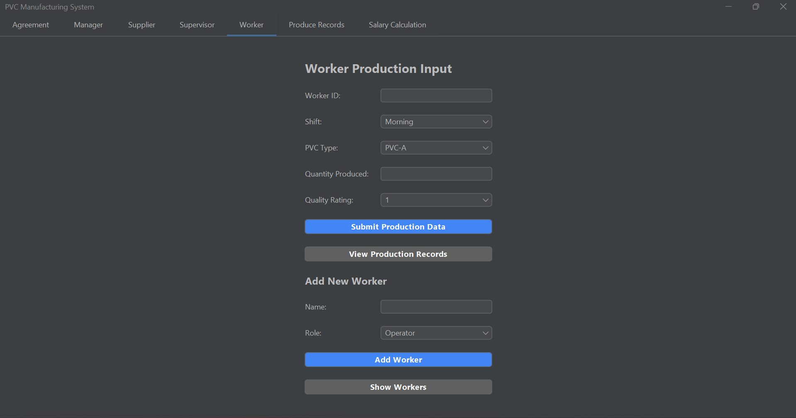
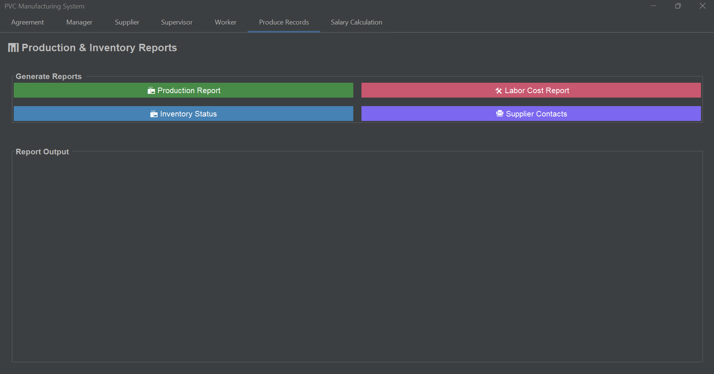

# PVC Manufacturing System

A desktop application (Java Swing + SQLite) for managing a PVC manufacturing plant: agreements with suppliers,
pellet deliveries, worker production input, supervisor monitoring, manager approvals and salary / labor-cost reports.
Built as a Software Engineering Project (SEP) in my 3rd semester.

> **Status: early coursework project.** It demonstrates GUI design, role-based screens and SQLite persistence,
> but it is not production-ready. See [Known limitations](#known-limitations) below.

**Stack:** Java 17, Swing with FlatLaf (dark theme), SQLite (`sqlite-jdbc`), Maven

## Screens
Tabs for each role: **Agreement**, **Manager**, **Supplier**, **Supervisor**, **Worker**, **Produce Records**, **Salary Calculation**,
plus a login page and a signup dialog.

| | |
|---|---|
|  |  |
|  |  |
|  |  |

## What it does
- Login / signup with role-based accounts
- Record supplier agreements and pellet deliveries
- Workers submit production data (shift, PVC type, quantity, quality rating) and can be added to the system
- Supervisors log issues and monitor shift output
- Managers can approve or reject overtime requests (the pending-approvals list is a fixed sample entry, see limitations)
- Generate production, inventory, supplier and labor-cost reports; manual salary calculator
- SQLite database and all tables are created automatically on first run (schema in `DatabaseManager.java`, foreign keys enforced, cascading deletes)

## Run
Requires JDK 17+ and Maven.
```bash
mvn compile
```
Then run `pvc.Main` from your IDE (or `mvn exec:java -Dexec.mainClass=pvc.Main`).
The SQLite file `pvc_project_full.db` is created in the working directory on first launch, together with a
**default demo admin account (`admin` / `admin123`)**.

## Known limitations
This was written early in my studies and I have not maintained it. Known issues:

- **Hard-coded values:** the Manager dashboard KPIs (daily production, defect rate, labor cost) are fixed placeholder values, not computed from the database.
  The Manager "pending approvals" entry is a fixed sample item, and new worker IDs are generated randomly rather than from a database sequence.
- **Weak security:** passwords are hashed with plain, unsalted SHA-256, and a default admin account with a known password is created on first run. Do not use this approach in a real system.
- **Incomplete features:** nothing in the app creates overtime requests, so the Manager "Approve / Reject" action has no real data to act on. Employee, inventory and some report tables exist in the schema but are only partly used. Error handling is minimal.
- **Outdated:** older dependency versions (FlatLaf 3.4, sqlite-jdbc 3.43) and a Swing UI; no automated tests.
- **Configuration:** the database path depends on the working directory, and there are no migrations or environment-based settings.

If I rebuilt it today I would move to a proper service layer, salted password hashing (bcrypt), computed dashboards and tests.

## Testing
The database layer was checked end to end against a fresh database (login, workers, production, deliveries, agreements, issues, reports),
and every screen was constructed and its report buttons clicked without errors. There is no automated test suite in the repo yet.
